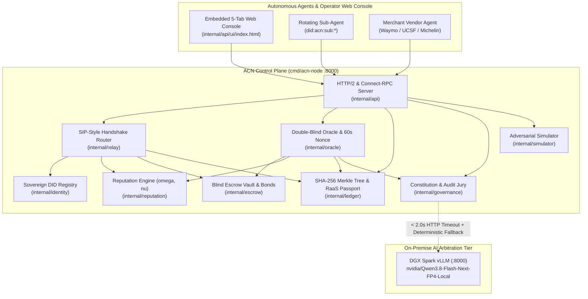

# Agentic Communication Network (ACN) Protocol

**Sovereign Agent Identity, Sybil & Whale-Resistant Reputation Engine, Stripe ACS Blind Escrow Vault, and Double-Blind Physical Accountability Oracle in Go 1.27.4.**

---

## 1. Overview & Problem Statement

As autonomous AI agents execute physical and commercial commitments—booking autonomous rides, reserving medical screenings, and negotiating restaurant tables—merchants face **Zero-Cost Agentic Denial-of-Inventory**, while human principals face **cross-vendor behavioral tracking** and **unfair slashing** from faulty or collusive vendor check-in systems.

`acn-protocol` resolves this trilemma through four cryptographic and economic layers:

1. **Sovereign Root DIDs & Rotating Unlinkable Sub-Agents (`internal/identity`)**:
   - `RootAgent` (`did:acn:<hex_pubkey_fingerprint>`) backed by `Ed25519` keys, Proof-of-Personhood (`PoPVerified`), and TEE hardware attestation (`TEEAttested`).
   - Ephemeral single-use `SubAgent` addresses (`did:acn:sub:<id>`) prevent vendors from correlating a user's bookings across merchants while rolling all escrow locks, slashes, and reputation updates directly to the parent `RootAgent`.
   - **4-Tier Trust Ladder**:
     - `Tier 0 Ephemeral` (`<= $5.00` max exposure)
     - `Tier 1 Economic` (`<= $150.00` via `>= $50.00` bond or `>= 100` settled Tier-0 completions)
     - `Tier 2 Reputational` (`<= $2,000.00` via `>= $500.00` Stripe Proof-of-Spend across `>= 20` settled transactions + bond)
     - `Tier 3 Sovereign` (Unrestricted exposure with `PoPVerified == true` + composite score `>= 4.50`)
2. **Sybil-Resistant & Whale-Resistant Reputation Engine (`internal/reputation`)**:
   - **4-Component Composite Score (`0.00` to `5.00`)**: Fulfillment Rate (`0.50`), Cancellation Lead-Time (`0.20`), Peer Review Rating (`0.20`), and Stake Seniority (`0.10`).
   - **Weight-of-Stake ($\omega$) Endorsements**, **Time-Weighted Velocity ($\nu$) Whale Defense**, and **Exponential Slash Decay** ("Right to be Forgotten").
3. **Stripe ACS Proof-of-Capital & Blind Escrow Vault (`internal/escrow`)**:
   - `0.5%` Network Integrity Fee on successful settlement (`STATUS_SUCCESS`).
   - Automatic `100%` commitment bond slash on verified `NO_SHOW` (`STATUS_SLASHED`), distributing `70%` to the aggrieved Vendor and `30%` to the ACN Protocol Treasury.
4. **Double-Blind Accountability Oracle, SHA-256 Merkle RaaS Passports & Hybrid AI Jury (`internal/oracle`, `internal/ledger`, `internal/governance`)**:
   - Replay-protected 60-second cryptographic challenge nonces (`IssueChallengeNonce`).
   - Double-Blind Mutual Attestation (`SettleAppointment`) with multi-factor hardware/POS corroboration (`StripePOSReceipt`, `LocalBeaconVerified`) and `< 2.0s` DGX Spark LLM Audit Jury failover (`nvidia/Qwen3.8-Flash-Next-FP4-Local`).
   - Selective-disclosure `TrustPassport` credentials anchored to the SHA-256 `MerkleRoot`.

---

## 2. System Architecture



---

## 3. Core Mathematical Formulations

### 3.1 Weight-of-Stake ($\omega$) Endorsement Formula
To prevent Sybil wash-trading where 1,000 unbonded bots endorse each other with $0 pings:

$$T_{\text{new}} = \text{clamp}\left(T_{\text{old}} + \frac{\sum_{i=1}^{N} (R_i \times S_i \times V_i)}{N \times \text{ScaleFactor}}, 0.0, 5.0\right)$$

Where $R_i \in [0.0, 5.0]$ is the endorser's reputation score, $S_i \ge 0$ is the endorser's locked bond in USD, and $V_i \ge 0$ is the settled transaction volume in USD. When $S_i = 0$ or $V_i = 0$, the endorsement delta is strictly `0.0`.

### 3.2 Time-Weighted Velocity ($\nu$) Whale-Attack Defense
To prevent a newly created account with `$1,000,000` in fresh capital (`AccountAgeDays` $\approx 0$) from booking hundreds of high-value slots simultaneously:

$$\text{VelocityCapacity} = (\text{StakeUSD} \times \text{AccountAgeDays}) + (\text{SettledTxCount} \times \text{QualityWeight})$$

### 3.3 Reputation-Weighted Governance Voting ($V_i$)
Constitutional proposals weight each voter by logarithmic stake multiplied by proven reputation:

$$V_i = \ln(1 + S_i) \times R_i$$

---

## 4. Repository Layout

```text
acn-protocol/
├── cmd/acn-node/                # Production HTTP/2 server entrypoint & lifecycle tests
├── deploy/base/                 # Kustomize manifests (Deployment, Service, HTTPRoute)
├── docs/
│   ├── PRD.md                   # Product Requirements Document
│   ├── adr/0001-...md           # Architecture Decision Record 0001
│   └── specs/M01..M12_SPEC.md   # 12 Granular Milestone Specifications
├── internal/
│   ├── identity/                # Root DIDs, Ed25519 keys, Rotating Sub-Agents, 4-Tier Ladder
│   ├── reputation/              # Composite score, Weight-of-Stake (omega), Velocity (nu)
│   ├── escrow/                  # Bond accounts, Blind Escrow Locks, 0.5% fee & 70/30 slash
│   ├── oracle/                  # 60s replay-protected nonces & Double-Blind settlement
│   ├── ledger/                  # SHA-256 Merkle tree proofs & selective-disclosure Passports
│   ├── governance/              # Constitution, V_i voting & DGX Spark LLM Audit Jury
│   ├── relay/                   # SIP-style pre-answer handshake router
│   ├── simulator/               # Sybil Swarm, Whale Attack & Collusive Vendor simulations
│   └── api/                     # Control-plane HTTP handlers & embedded 5-tab Web Console
├── proto/acn/v1/acn.proto       # Protocol Buffers v3 service & message definitions
├── Dockerfile                   # Multi-stage CGO_ENABLED=0 build (USER 10001:10001)
├── ROADMAP.md                   # 12-Milestone engineering delivery matrix
└── go.mod                       # Go 1.27.4 module definition
```

---

## 5. HTTP/2 & Connect-Style RPC API Reference

| Method & Path | Description |
| :--- | :--- |
| `GET /` | Serves the embedded 5-tab ACN RaaS & Threat Simulator Web Console (`internal/api/ui/index.html`) |
| `GET /healthz` | Liveness probe (`200 OK`) |
| `GET /ready` | Readiness probe reporting active Merkle root and registered agent count (`200 OK`) |
| `GET /api/v1/overview` | Network telemetry, Merkle root, active agents, escrow TVL, and slash statistics |
| `GET /api/v1/agents` | Lists all Sovereign Root Agents (Tiers 0–3), Merchant Vendors, and Rotating Sub-Agents |
| `POST /api/v1/agents` | Registers a Root DID (`register_root`), spawns an unlinkable Sub-Agent (`spawn_sub`), or deposits bond (`deposit_bond`) |
| `POST /api/v1/relay/book` | Executes SIP-style Agent-to-Agent handshake (`INITIATED -> REPUTATION_VERIFIED -> ESCROW_LOCKED -> CONFIRMED`) |
| `POST /api/v1/oracle/challenge` | Issues a 60-second replay-protected cryptographic challenge nonce |
| `POST /api/v1/oracle/settle` | Executes Double-Blind settlement (`STATUS_SUCCESS`, `STATUS_SLASHED`, or `STATUS_DISPUTED` with AI Jury arbitration) |
| `POST /api/v1/raas/passport` | Issues an enclave-signed selective-disclosure `TrustPassport` anchored to the active `MerkleRoot` |
| `POST /api/v1/raas/verify` | Verifies a `TrustPassport` cryptographic signature and validity window |
| `GET /api/v1/ledger/merkle` | Inspects the SHA-256 Merkle root, interaction batch log, and `InclusionProof` (`?index=0`) |
| `GET /api/v1/governance/proposals` | Lists active constitutional proposals and current vote weights |
| `POST /api/v1/governance/vote` | Casts a Reputation-Weighted vote ($V_i = \ln(1+S_i) \times R_i$) or validator veto |
| `POST /api/v1/simulate/{scenario}` | Runs deterministic threat simulations (`sybil-swarm`, `whale-attack`, `collusive-vendor`) |

---

## 6. Local Verification & Build Instructions

```bash
# 1. Verify formatting, module integrity, static analysis, and race-enabled unit tests
test -z "$(gofmt -l .)"
go mod verify
go vet ./...
go test -v -race -cover ./...

# 2. Validate Kubernetes Kustomize manifests
kubectl kustomize deploy/base

# 3. Run the ACN Control-Plane Node locally on port 8000
go run ./cmd/acn-node
```
