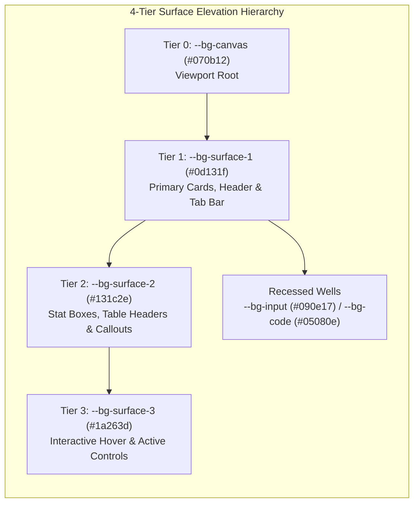

# ACN Protocol — Product & Visual Design System (`v2-ux`)

**Document Version:** 2.0.0  
**Status:** Gate 1 Approved  
**Owner:** Staff Product & Visual Systems Designer (`@product-designer`)  
**Repository:** [github.com/paulojauregui/acn-protocol](file:///home/tron/workspace/acn-protocol)  
**Target Modules:** [internal/api/ui/tokens.css](file:///home/tron/workspace/acn-protocol/internal/api/ui/tokens.css), [internal/api/ui/components.css](file:///home/tron/workspace/acn-protocol/internal/api/ui/components.css), [internal/api/ui/index.html](file:///home/tron/workspace/acn-protocol/internal/api/ui/index.html)

---

## 1. Aesthetic Direction & Visual Philosophy

### 1.1 Aesthetic Archetype: Sovereign Cryptographic Trust-and-Escrow Mission Control
The ACN Protocol Engineering Console is an institutional-grade cryptographic control plane for autonomous agent identity, blind escrow collateralization, 60-second double-blind presence verification, Merkle ledger auditing, and adversarial threat simulation.

The visual system rejects decorative consumer SaaS conventions (heavy drop shadows, arbitrary multi-stop gradients, rounded pill bloat, and low-contrast muted typography) in favor of **High-Density Institutional Telemetry**:
1. **Strict 4-Tier Surface Elevation**: Depth and hierarchy are communicated exclusively through stepped dark-slate luminance (`#070b12` -> `#0d131f` -> `#131c2e` -> `#1a263d`) bounded by crisp `1px` structural hairlines (`#1b263b` / `#24324d`).
2. **Cryptographic & Financial Legibility**: Decentralized Identifiers (`did:acn:...`), SHA-256 Merkle roots, ECDSA signatures, 60s challenge nonces, USD escrow balances, and `0.00-5.00` composite reputation scores are treated as first-class telemetry primitives with monospace precision and strict vertical digit alignment (`font-variant-numeric: tabular-nums`).
3. **Deterministic 5-State Feedback**: Every operational surface explicitly communicates `Empty`, `Loading` (`CLS = 0` fixed-geometry skeletons), `Nominal`, `Degraded Fallback` (`DETERMINISTIC_MULTI_FACTOR` when the remote DGX Spark LLM is unreachable), and `Error` states without browser-blocking `window.alert()` dialogs.
4. **Zero-Emoji Invariant**: All status indicators, trust tiers, and protocol phases use typographic badges, geometric state nodes, and semantic border/fill tokens. Emojis are strictly prohibited across all UI templates, stylesheets, scripts, and documentation.



---

## 2. Design Token Contract (`internal/api/ui/tokens.css`)

All visual rules across the ACN Protocol Console must consume CSS custom properties declared in `internal/api/ui/tokens.css`. Hardcoded hex values outside `tokens.css` are prohibited.

### 2.1 Surface Hierarchy & Legacy Compatibility Aliases

| Token Name | Hex Value | Tier / Role | Usage Contract |
| :--- | :--- | :--- | :--- |
| `--bg-canvas` | `#070b12` | **Tier 0 (Canvas)** | Root `<body>` viewport background |
| `--bg-surface-1` | `#0d131f` | **Tier 1 (Primary Surface)** | `.card`, `<header>`, `nav.tab-bar`, `<footer>` |
| `--bg-surface-2` | `#131c2e` | **Tier 2 (Elevated Surface)** | `.stat-box`, `.pill`, `th` table headers, `.attack-card`, `.jury-callout` |
| `--bg-surface-3` | `#1a263d` | **Tier 3 (Interactive / Hover)** | `.btn-secondary:hover`, active table row hover, filter controls |
| `--bg-input` | `#090e17` | **Recessed Input Well** | `.form-control`, `input`, `select`, search inputs |
| `--bg-code` | `#05080e` | **Recessed Telemetry Well** | `pre.json-viewer`, Merkle proof payloads, raw JSON receipts |
| `--bg-dark` | `var(--bg-canvas)` | Legacy Alias | Preserved for backwards compatibility with v1 selectors |
| `--bg-panel` | `var(--bg-surface-1)` | Legacy Alias | Preserved for backwards compatibility with v1 selectors |
| `--bg-card` | `var(--bg-surface-2)` | Legacy Alias | Preserved for backwards compatibility with v1 selectors |

### 2.2 Hairline Borders & Keyboard Focus Rings

| Token Name | Value | Contrast / Role | Usage Contract |
| :--- | :--- | :--- | :--- |
| `--border-subtle` | `#1b263b` | Structural divider | Table row separators (`td`), internal card section dividers |
| `--border-default` | `#24324d` | Primary container hairline | `.card`, `.stat-box`, `.pill`, `.table-responsive`, `.form-control` |
| `--border-strong` | `#33476b` | Emphasized boundary | Hover borders, active `.step-circle` idle rings, `.filter-toolbar` |
| `--border-focus` | `#38bdf8` | Keyboard / Input focus | `:focus-visible` outline color, active tab indicator, `.form-control:focus` |
| `--focus-ring` | `0 0 0 2px rgba(56, 189, 248, 0.45)` | High-visibility focus halo | Applied alongside `border-color: var(--border-focus)` on `:focus-visible` |
| `--border-color` | `var(--border-default)` | Legacy Alias | Maps v1 `--border-color` to `--border-default` |
| `--border-active` | `var(--border-focus)` | Legacy Alias | Maps v1 `--border-active` to `--border-focus` |

### 2.3 Text Hierarchy & WCAG 2.2 AA Contrast Verification

All text tokens are verified against `--bg-canvas` (`#070b12`), `--bg-surface-1` (`#0d131f`), and `--bg-surface-2` (`#131c2e`) to guarantee WCAG 2.2 AA compliance (`>= 4.5:1` for normal text). Note that v1's `--text-dim` (`#64748b`, `3.3:1` on `#131c2e`) has been elevated to `#8b9bb4` (`5.4:1` on `#131c2e`) to eliminate low-contrast violations.

| Token Name | Hex Value | Contrast vs `--bg-surface-1` (`#0d131f`) | Contrast vs `--bg-surface-2` (`#131c2e`) | Usage Contract |
| :--- | :--- | :--- | :--- | :--- |
| `--text-main` | `#f1f5f9` | `15.6:1` (AAA) | `13.8:1` (AAA) | Primary prose, table cell values, `.stat-val`, `.pill-val`, active tabs |
| `--text-muted` | `#94a3b8` | `6.8:1` (AA) | `6.0:1` (AA) | Card descriptions, subtitle prose, inactive `.tab-btn`, secondary metadata |
| `--text-dim` | `#8b9bb4` | `6.1:1` (AA) | `5.4:1` (AA) | `.stat-label`, `.pill-label`, `th` column headers, `.form-group label`, timestamps |
| `--text-on-accent` | `#04101e` | `11.4:1` vs `#38bdf8` | `14.1:1` vs `#7dd3fc` | Foreground label text on primary `--accent-blue` buttons |

### 2.4 Semantic Status & 4-Tier Trust Palette (WCAG 2.2 AA `>= 4.5:1`)

Every trust tier, settlement status, and arbitration engine state maps to a dedicated triple of background, foreground text, and `1px` border tokens:

| Semantic Role / Class | Background Token | Foreground Token | Border Token | Contrast Ratio | Protocol Meaning |
| :--- | :--- | :--- | :--- | :--- | :--- |
| **Tier 0 Ephemeral** (`.badge-t0`) | `--badge-t0-bg: #162032` | `--badge-t0-fg: #cbd5e1` | `--badge-t0-border: #334155` | `10.1:1` (AAA) | Unbonded agent (`Max Exposure <= $10.00`), idle state |
| **Tier 1 Economic** (`.badge-t1`) | `--badge-t1-bg: #082f49` | `--badge-t1-fg: #38bdf8` | `--badge-t1-border: #0369a1` | `7.0:1` (AAA) | Bonded economic commuter (`Bond >= $50.00`) |
| **Tier 2 Reputational** (`.badge-t2`) | `--badge-t2-bg: #2e1065` | `--badge-t2-fg: #d8b4fe` | `--badge-t2-border: #6b21a8` | `8.8:1` (AAA) | Longitudinal history + RaaS Enclave attestation |
| **Tier 3 Sovereign** (`.badge-t3`) | `--badge-t3-bg: #052e16` | `--badge-t3-fg: #4ade80` | `--badge-t3-border: #166534` | `9.5:1` (AAA) | PoP verified + TEE attested sovereign executive |
| **Merchant Vendor** (`.badge-vendor`) | `--badge-vendor-bg: #451a03` | `--badge-vendor-fg: #fdba74` | `--badge-vendor-border: #9a3412` | `8.8:1` (AAA) | High-value service provider (`Waymo`, `UCSF`, `Michelin`) |
| **Success / Active** (`.badge-success`) | `--status-ok-bg: #052e16` | `--status-ok-fg: #4ade80` | `--status-ok-border: #166534` | `9.5:1` (AAA) | `STATUS_SUCCESS`, `CONFIRMED`, `ACTIVE`, `PoP`, `TEE`, `[PASS]` |
| **Slashed / Danger** (`.badge-danger`) | `--status-danger-bg: #450a0a` | `--status-danger-fg: #fca5a5` | `--status-danger-border: #991b1b` | `8.3:1` (AAA) | `STATUS_SLASHED`, `EXPIRED`, `REJECTED_LOW_TRUST`, `[FAIL]` |
| **Disputed / Warning** (`.badge-warning`) | `--status-warn-bg: #451a03` | `--status-warn-fg: #facc15` | `--status-warn-border: #854d0e` | `9.7:1` (AAA) | `STATUS_DISPUTED`, adversarial attack vector tags (`SWARM`, `VELOCITY`) |
| **Degraded Fallback** (`.badge-degraded`) | `--status-degraded-bg: #2e1905` | `--status-degraded-fg: #fbbf24` | `--status-degraded-border: #d97706` | `9.1:1` (AAA) | `DETERMINISTIC_MULTI_FACTOR` local heuristic fallback when DGX Spark LLM is offline |

---

## 3. Typography & Strict `tabular-nums` Discipline

### 3.1 Font Stacks & Scale
- `--font-sans`: `-apple-system, BlinkMacSystemFont, "Segoe UI", Roboto, "Inter", Helvetica, Arial, sans-serif`
- `--font-mono`: `ui-monospace, SFMono-Regular, "JetBrains Mono", Menlo, Monaco, Consolas, "Liberation Mono", "Courier New", monospace`

| Token | REM | PX | Line Height | Weight | Primary Usage |
| :--- | :--- | :--- | :--- | :--- | :--- |
| `--text-2xs` | `0.625rem` | `10px` | `1.2` | `600` | `.pill-label` uppercase micro-headers |
| `--text-xs` | `0.6875rem` | `11px` | `1.35` | `600` | `.stat-label`, `th`, `.form-group label`, `.badge`, `.step-title`, `footer` |
| `--text-sm` | `0.75rem` | `12px` | `1.45` | `400` / `600` | `.pill`, `.code-span`, `pre.json-viewer`, `.attack-desc`, `.attack-defense` |
| `--text-base` | `0.8125rem` | `13px` | `1.5` | `400` / `600` | `table`, `.form-control`, `.btn`, `.tab-btn`, card body copy |
| `--text-md` | `0.875rem` | `14px` | `1.5` | `700` | `body` base size, `.card-title`, `.attack-title` |
| `--text-lg` | `1.125rem` | `18px` | `1.3` | `700` | `.brand h1` console header title |
| `--text-xl` | `1.25rem` | `20px` | `1.2` | `700` | `.stat-val` primary financial & escrow metrics |

### 3.2 Mandatory `font-variant-numeric: tabular-nums` Contract
To prevent horizontal layout jitter during 1-second challenge nonce countdowns, live escrow balance updates, and adversarial simulation telemetry renders, `font-variant-numeric: tabular-nums` is enforced on all numeric and cryptographic selectors:

1. **Utility & Structural Classes**: `.tabular-nums`, `.stat-val`, `.pill-val`, `.code-span`, `.badge`, `.step-circle`, `td.num`, `th.num`.
2. **Header & Overview Telemetry**: `#pill-registered-agents`, `#pill-sub-agents`, `#pill-escrow-locked`, `#pill-treasury-fees`, `#stat-locked-usd`, `#stat-avail-usd`, `#stat-fees-usd`, `#stat-slashed-usd`.
3. **Trust Ladder & Agent Registry Columns**: Min Bond, Min Spend, Settled Tx, Max Exposure, `bond_usd`, `cumulative_spend_usd`, `settled_tx_count`, Composite Reputation (`0.00 / 5.00`), Sub-Agent timestamps (`created_at`, `expires_at`).
4. **Oracle 60s Challenge & Settlement**: `#orc-nonce-display`, `#orc-nonce-timer` (`60s` -> `0s` countdown), `#settle-amount`, `#settle-rating`.
5. **RaaS & Merkle Ledger**: `#merkle-ledger-root`, `#merkle-proof-idx`, `amount_usd`, record timestamps.
6. **Adversarial Simulator Readouts**: Sybil bot count (`1,000`), trapped percentage (`100.0%`), Whale deposit (`$1,000,000.00`), velocity capacities (`$0.00`, `$50,000.00`), simulation latency (`duration_ms`).

---

## 4. Spatial Grid (`4px` / `8px` Rhythm) & Responsive Breakpoints

### 4.1 Spacing & Radius Tokens
| Token | Value (`px` / `rem`) | Usage |
| :--- | :--- | :--- |
| `--space-1` | `4px` (`0.25rem`) | Tight inline badge gap, `.brand` stack gap |
| `--space-2` | `8px` (`0.5rem`) | `.pill` internal gap, button groups, `.card-title` bottom padding |
| `--space-3` | `12px` (`0.75rem`) | Table cell padding (`10px 12px`), `.form-row` gap, `.attack-card` internal gap |
| `--space-4` | `16px` (`1.0rem`) | `.grid-3` / `.grid-4` gap, `.card` internal stack gap, header gap |
| `--space-5` | `20px` (`1.25rem`) | `.grid-2` gap, `.card` padding (`20px`) |
| `--space-6` | `24px` (`1.5rem`) | `<main>` padding, `.tab-content` vertical stack gap, `<header>` horizontal padding |
| `--space-8` | `32px` (`2.0rem`) | Major section separation |
| `--radius-sm` | `4px` | `.badge`, `.code-span`, `.attack-defense` |
| `--radius-md` | `6px` | `.pill`, `.stat-box`, `.form-control`, `.btn`, `.table-responsive`, `pre.json-viewer` |
| `--radius-lg` | `8px` | `.card`, `.attack-card`, `.status-banner`, `.jury-callout` |

### 4.2 Responsive Viewport Matrix (`375px` to `2560px`)

| Breakpoint Tier | Viewport Range | Layout & Grid Behavior |
| :--- | :--- | :--- |
| **Mobile** | `375px - 767px` | `<main>` padding reduces to `var(--space-4)` (`16px`). `.grid-2`, `.grid-3`, `.grid-4`, and `.form-row` collapse to a single `1fr` column (`grid-template-columns: 1fr`). `.stepper` switches from horizontal track to vertical timeline (`flex-direction: column`). `.table-responsive` scrolls horizontally (`overflow-x: auto; -webkit-overflow-scrolling: touch`) with zero page-level horizontal overflow. |
| **Tablet** | `768px - 1023px` | `.grid-4` renders `2x2` (`repeat(2, 1fr)`). `.grid-2` and `.grid-3` stack or wrap cleanly at `minmax(320px, 1fr)`. `.filter-toolbar` wraps controls across two rows. |
| **Desktop** | `1024px - 1599px` | Full multi-column mission control layout: `.grid-4` (`4` columns), `.grid-3` (`3` columns), `.grid-2` (`2` columns). Horizontal 4-node `.stepper`. |
| **Ultrawide / 4K** | `1600px - 2560px+` | `<main>` is constrained to `max-width: 1600px; margin: 0 auto` so tables and telemetry panels maintain optimal scanning eye-span across 4K displays. |

---

## 5. Complete Reference Implementation: `internal/api/ui/tokens.css`

```css
/* ACN Protocol Design System Tokens (v2-ux)
 * Aesthetic: Sovereign Cryptographic Trust-and-Escrow Mission Control
 * Invariants: 4-tier dark surface elevation, WCAG 2.2 AA (>= 4.5:1), zero magic hex outside :root
 */

:root {
  /* 1. 4-Tier Surface Elevation Hierarchy */
  --bg-canvas: #070b12;
  --bg-surface-1: #0d131f;
  --bg-surface-2: #131c2e;
  --bg-surface-3: #1a263d;
  --bg-input: #090e17;
  --bg-code: #05080e;

  /* Backwards-compatible v1 surface aliases */
  --bg-dark: var(--bg-canvas);
  --bg-panel: var(--bg-surface-1);
  --bg-card: var(--bg-surface-2);

  /* 2. Hairline Borders & Focus Rings */
  --border-subtle: #1b263b;
  --border-default: #24324d;
  --border-strong: #33476b;
  --border-focus: #38bdf8;
  --focus-ring: 0 0 0 2px rgba(56, 189, 248, 0.45);

  /* Backwards-compatible v1 border aliases */
  --border-color: var(--border-default);
  --border-active: var(--border-focus);

  /* 3. Typography & Text Contrast Hierarchy (WCAG 2.2 AA verified) */
  --text-main: #f1f5f9;
  --text-muted: #94a3b8;
  --text-dim: #8b9bb4;
  --text-on-accent: #04101e;

  --font-sans: -apple-system, BlinkMacSystemFont, "Segoe UI", Roboto, "Inter", Helvetica, Arial, sans-serif;
  --font-mono: ui-monospace, SFMono-Regular, "JetBrains Mono", Menlo, Monaco, Consolas, "Liberation Mono", "Courier New", monospace;

  --text-2xs: 0.625rem;   /* 10px */
  --text-xs: 0.6875rem;   /* 11px */
  --text-sm: 0.75rem;     /* 12px */
  --text-base: 0.8125rem; /* 13px */
  --text-md: 0.875rem;    /* 14px */
  --text-lg: 1.125rem;    /* 18px */
  --text-xl: 1.25rem;     /* 20px */

  /* 4. Primary Accents */
  --accent-blue: #38bdf8;
  --accent-blue-hover: #7dd3fc;
  --accent-green: #4ade80;
  --accent-amber: #fbbf24;
  --accent-red: #f87171;
  --accent-purple: #c084fc;

  /* 5. Semantic Trust Tier Tokens (WCAG 2.2 AA >= 7.0:1) */
  --badge-t0-bg: #162032;
  --badge-t0-fg: #cbd5e1;
  --badge-t0-border: #334155;

  --badge-t1-bg: #082f49;
  --badge-t1-fg: #38bdf8;
  --badge-t1-border: #0369a1;

  --badge-t2-bg: #2e1065;
  --badge-t2-fg: #d8b4fe;
  --badge-t2-border: #6b21a8;

  --badge-t3-bg: #052e16;
  --badge-t3-fg: #4ade80;
  --badge-t3-border: #166534;

  --badge-vendor-bg: #451a03;
  --badge-vendor-fg: #fdba74;
  --badge-vendor-border: #9a3412;

  /* 6. Semantic Protocol Status Tokens */
  --status-ok-bg: #052e16;
  --status-ok-fg: #4ade80;
  --status-ok-border: #166534;

  --status-danger-bg: #450a0a;
  --status-danger-fg: #fca5a5;
  --status-danger-border: #991b1b;

  --status-warn-bg: #451a03;
  --status-warn-fg: #facc15;
  --status-warn-border: #854d0e;

  --status-degraded-bg: #2e1905;
  --status-degraded-fg: #fbbf24;
  --status-degraded-border: #d97706;

  --status-info-bg: #082f49;
  --status-info-fg: #7dd3fc;
  --status-info-border: #0369a1;

  /* 7. Spatial Scale (4px / 8px Rhythm) & Radii */
  --space-1: 0.25rem; /* 4px */
  --space-2: 0.5rem;  /* 8px */
  --space-3: 0.75rem; /* 12px */
  --space-4: 1rem;    /* 16px */
  --space-5: 1.25rem; /* 20px */
  --space-6: 1.5rem;  /* 24px */
  --space-8: 2rem;    /* 32px */

  --radius-sm: 4px;
  --radius-md: 6px;
  --radius-lg: 8px;

  /* 8. Motion & Transitions */
  --ease-out-expo: cubic-bezier(0.16, 1, 0.3, 1);
  --duration-fast: 140ms;
}
```

---

## 6. Component Blueprints (`internal/api/ui/components.css`)

### 6.1 Accessibility Skip Link (`.skip-link`)
Allows keyboard operators to bypass top telemetry and jump directly to `<main id="main-workspace">`.
```css
.skip-link {
  position: absolute;
  top: -48px;
  left: var(--space-4);
  z-index: 1000;
  background-color: var(--accent-blue);
  color: var(--text-on-accent);
  font-family: var(--font-sans);
  font-size: var(--text-sm);
  font-weight: 700;
  padding: var(--space-2) var(--space-4);
  border-radius: var(--radius-md);
  text-decoration: none;
  transition: top var(--duration-fast) var(--ease-out-expo);
}

.skip-link:focus,
.skip-link:focus-visible {
  top: var(--space-3);
  outline: none;
  box-shadow: var(--focus-ring);
}
```

### 6.2 5-State Deterministic Status Banner (`.status-banner`)
Replaces blocking `window.alert()` dialogs with an inline, `aria-live="polite"` / `role="status"` banner supporting `data-state="empty|loading|nominal|degraded|error"`.
```css
.status-banner {
  display: flex;
  align-items: center;
  justify-content: space-between;
  gap: var(--space-3);
  padding: var(--space-3) var(--space-4);
  border-radius: var(--radius-lg);
  border: 1px solid var(--border-default);
  background-color: var(--bg-surface-2);
  color: var(--text-main);
  font-size: var(--text-base);
}

.status-banner[hidden] {
  display: none !important;
}

.status-banner[data-state="empty"] {
  background-color: var(--bg-surface-1);
  border-color: var(--border-subtle);
  color: var(--text-muted);
}

.status-banner[data-state="loading"] {
  background-color: var(--status-info-bg);
  border-color: var(--status-info-border);
  color: var(--status-info-fg);
}

.status-banner[data-state="nominal"] {
  background-color: var(--status-ok-bg);
  border-color: var(--status-ok-border);
  color: var(--status-ok-fg);
}

.status-banner[data-state="degraded"] {
  background-color: var(--status-degraded-bg);
  border: 1px dashed var(--status-degraded-border);
  color: var(--status-degraded-fg);
}

.status-banner[data-state="error"] {
  background-color: var(--status-danger-bg);
  border-color: var(--status-danger-border);
  color: var(--status-danger-fg);
}
```

### 6.3 Zero-CLS Fixed-Geometry Skeletons (`.skeleton-row`, `.skeleton-block`)
Used while `/api/v1/overview`, `/api/v1/agents`, and `/api/v1/ledger/merkle` are in flight so table rows and stat boxes preserve exact pixel height (`CLS = 0`).
```css
@keyframes acn-skeleton-pulse {
  0%, 100% { opacity: 0.45; }
  50% { opacity: 0.85; }
}

.skeleton-block,
.skeleton-row td::before {
  display: block;
  background-color: var(--bg-surface-3);
  border-radius: var(--radius-sm);
  animation: acn-skeleton-pulse 1.4s ease-in-out infinite;
}

.skeleton-block {
  height: 20px;
  width: 100%;
}

.skeleton-row td {
  height: 45px;
  vertical-align: middle;
}

.skeleton-row td::before {
  content: "";
  height: 14px;
  width: 80%;
}
```

### 6.4 Directory Filter & Search Toolbar (`.filter-toolbar`)
Provides instant client-side filtering of the Sovereign Root Agent Directory by search string (`display_name` / `root_did`), Trust Tier (`0-3`), and Role (`Sovereign Agent` vs `Merchant Vendor`).
```css
.filter-toolbar {
  display: flex;
  flex-wrap: wrap;
  align-items: center;
  justify-content: space-between;
  gap: var(--space-3);
  padding: var(--space-3);
  background-color: var(--bg-surface-2);
  border: 1px solid var(--border-default);
  border-radius: var(--radius-md);
}

.filter-toolbar .filter-group {
  display: flex;
  flex-wrap: wrap;
  align-items: center;
  gap: var(--space-2);
  flex: 1;
}

.filter-toolbar .form-control {
  min-width: 160px;
}
```

### 6.5 4-Phase Relay State Machine Stepper (`.stepper`, `.step-node`)
Visualizes `1. INITIATED -> 2. REPUTATION VERIFIED -> 3. ESCROW LOCKED -> 4. CONFIRMED | REJECTED`.
```css
.stepper {
  display: flex;
  justify-content: space-between;
  position: relative;
  margin: var(--space-4) 0 var(--space-6) 0;
}

.stepper::before {
  content: "";
  position: absolute;
  top: 15px;
  left: 24px;
  right: 24px;
  height: 2px;
  background: var(--border-default);
  z-index: 1;
}

.step-node {
  position: relative;
  z-index: 2;
  display: flex;
  flex-direction: column;
  align-items: center;
  gap: var(--space-2);
  width: 140px;
}

.step-circle {
  width: 32px;
  height: 32px;
  border-radius: 50%;
  background: var(--bg-surface-2);
  border: 2px solid var(--border-strong);
  display: flex;
  align-items: center;
  justify-content: center;
  font-family: var(--font-mono);
  font-variant-numeric: tabular-nums;
  font-weight: 700;
  font-size: var(--text-sm);
  color: var(--text-dim);
  transition: border-color var(--duration-fast) var(--ease-out-expo),
              background-color var(--duration-fast) var(--ease-out-expo);
}

.step-node.completed .step-circle {
  border-color: var(--status-ok-border);
  background: var(--status-ok-bg);
  color: var(--status-ok-fg);
}

.step-node.active .step-circle {
  border-color: var(--border-focus);
  background: var(--badge-t1-bg);
  color: var(--badge-t1-fg);
  box-shadow: var(--focus-ring);
}

.step-node.failed .step-circle {
  border-color: var(--status-danger-border);
  background: var(--status-danger-bg);
  color: var(--status-danger-fg);
}
```

### 6.6 Hybrid AI Audit Jury Callout (`.jury-callout`, `.badge-degraded`)
Prominently surfaces the `JuryVerdict` on Tab 3 (`STATUS_DISPUTED`) and distinguishes between primary `DGX_SPARK_LLM` arbitration and `DETERMINISTIC_MULTI_FACTOR` local heuristic fallback.
```css
.jury-callout {
  background-color: var(--bg-surface-2);
  border: 1px solid var(--border-default);
  border-left: 3px solid var(--accent-blue);
  border-radius: var(--radius-md);
  padding: var(--space-4);
  display: flex;
  flex-direction: column;
  gap: var(--space-2);
}

.jury-callout[data-engine="DETERMINISTIC_MULTI_FACTOR"] {
  border-left-color: var(--status-degraded-border);
  background-color: var(--status-degraded-bg);
}

.badge-degraded {
  background-color: var(--status-degraded-bg);
  color: var(--status-degraded-fg);
  border: 1px dashed var(--status-degraded-border);
}
```

### 6.7 Adversarial Attack Scenario Card (`.attack-card`)
Encapsulates the 3 threat simulations (*1,000-Bot Sybil Swarm*, *\$1M Whale Capital Attack*, *Collusive Vendor Fraud*).
```css
.attack-card {
  background-color: var(--bg-surface-2);
  border: 1px solid var(--border-default);
  border-radius: var(--radius-lg);
  padding: var(--space-4);
  display: flex;
  flex-direction: column;
  justify-content: space-between;
  gap: var(--space-3);
  transition: border-color var(--duration-fast) var(--ease-out-expo);
}

.attack-card:hover,
.attack-card.active-attack {
  border-color: var(--status-degraded-border);
}

.attack-defense {
  font-size: var(--text-sm);
  color: var(--status-info-fg);
  background: var(--status-info-bg);
  border: 1px solid var(--status-info-border);
  border-radius: var(--radius-sm);
  padding: var(--space-2) var(--space-3);
}
```

---

## 7. Motion & Reduced-Motion Contract (`prefers-reduced-motion: reduce`)

All transitions are functional and bounded to `140ms cubic-bezier(0.16, 1, 0.3, 1)`. When the operating system or browser reports `prefers-reduced-motion: reduce`, keyframe animations (skeleton pulses) and layout transitions are disabled:

```css
@media (prefers-reduced-motion: reduce) {
  *,
  *::before,
  *::after {
    animation-duration: 0.01ms !important;
    animation-iteration-count: 1 !important;
    transition-duration: 0.01ms !important;
    scroll-behavior: auto !important;
  }

  .skeleton-block,
  .skeleton-row td::before {
    animation: none !important;
    opacity: 0.65;
  }
}
```

---

## 8. Responsive Media Queries Specification

```css
@media (max-width: 1023px) {
  .grid-4 {
    grid-template-columns: repeat(2, 1fr);
  }
}

@media (max-width: 767px) {
  header {
    padding: var(--space-3) var(--space-4);
  }

  nav.tab-bar {
    padding: 0 var(--space-3);
  }

  main {
    padding: var(--space-4);
  }

  .grid-2,
  .grid-3,
  .grid-4,
  .form-row {
    grid-template-columns: 1fr;
  }

  .stepper {
    flex-direction: column;
    align-items: flex-start;
    gap: var(--space-3);
  }

  .stepper::before {
    top: 16px;
    bottom: 16px;
    left: 15px;
    right: auto;
    width: 2px;
    height: auto;
  }

  .step-node {
    flex-direction: row;
    width: 100%;
    gap: var(--space-3);
  }

  .step-title {
    text-align: left;
  }
}

@media (min-width: 1600px) {
  main {
    max-width: 1600px;
  }
}
```

---

## 9. Gate 3 Visual Craft & Token Audit Checklist

Before opening any Pull Request for `v2-ux`, the implementation must pass the following verification checks:
1. **Zero Magic Hex Colors**: `internal/api/ui/components.css` and `internal/api/ui/index.html` reference CSS variables from `internal/api/ui/tokens.css` exclusively.
2. **Tabular-Nums Coverage**: Every USD amount, reputation score (`0.00-5.00`), 60s timer (`#orc-nonce-timer`), Merkle hash, and simulator metric uses `font-variant-numeric: tabular-nums`.
3. **WCAG 2.2 AA Contrast**: All text and badge foreground/background pairs maintain `>= 4.5:1` contrast (with `--text-dim` elevated to `#8b9bb4` at `>= 5.4:1`).
4. **Degraded Fallback Visibility**: `DETERMINISTIC_MULTI_FACTOR` verdicts render `.badge-degraded` and `.jury-callout[data-engine="DETERMINISTIC_MULTI_FACTOR"]` with explicit visual differentiation from `DGX_SPARK_LLM`.
5. **Zero Emojis**: Verified via regex scan across `docs/DESIGN_SYSTEM.md` and `internal/api/ui/*`.
