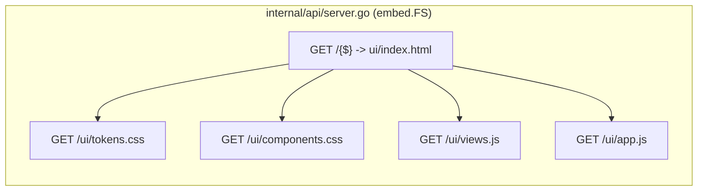

# UX & Interaction Architecture Specification: ACN Protocol Console (`v2-ux`)

**Document Version:** 2.0.0  
**Status:** Gate 1 Approved  
**Author:** Principal UI/UX & Interaction Architect (`@ux-architect`)  
**Repository:** `github.com/paulojauregui/acn-protocol`  

---

## 1. Executive Summary & Architectural Objectives

Iteration 2 (`v2-ux`) refactors the embedded Agentic Communication Network (ACN) Protocol Web Console from a 1,946-line single-file HTML monolith (`internal/api/ui/index.html`) into a modular, keyboard-first, WCAG 2.2 AA accessible single-page engineering console served via Go `embed.FS`.

Key UX and architectural improvements introduced in `v2-ux`:
1. **Modular Embedded Asset Topology**: Decouples markup (`index.html`), design tokens (`/ui/tokens.css`), component styles (`/ui/components.css`), core state/routing/fetch controller (`/ui/app.js`), and view renderers (`/ui/views.js`).
2. **Complete 5-State Determinism**: Every interactive view and data surface deterministically renders `Empty`, `Loading` (`CLS = 0` geometry-matched skeletons), `Nominal`, `Degraded / Offline Fallback` (explicitly surfacing `governance.EngineDeterministic` vs. `governance.EngineDGXSparkLLM`), and `Error` (inline recoverable `role="alert"` banners replacing blocking browser `window.alert()` dialogs).
3. **Keyboard-First & WCAG 2.2 AA Compliance**: Implements a skip-to-main link, semantic HTML5 landmarks, WAI-ARIA `tablist`/`tab`/`tabpanel` with roving `tabindex` and arrow-key navigation, global `/` and `Cmd/Ctrl+K` quick directory filtering (`#agent-filter-input`), explicit `<label for="...">` bindings on all 28 form controls, and live polite/assertive screen-reader announcements.
4. **Wire-Protocol Payload Fidelity**: Normalizes frontend field resolution for `SubAgent` (`sub.sub_did || sub.sub_agent_did`) and `NegotiationSession` (`session.state || session.status`) to match the authoritative Go structs in `internal/identity/did.go` and `internal/relay/router.go`.

---

## 2. Target Operator Personas & Core Jobs-to-be-Done (JTBD)

| Persona | Role & Operational Context | Primary Jobs-to-be-Done (JTBD) | Key Telemetry & Controls Required |
| :--- | :--- | :--- | :--- |
| **1. Protocol SRE (`Persona A`)** | Infrastructure & Cryptographic Reliability Engineer operating the ACN control plane on `mainframe`. | 1. Audit Sovereign Root DIDs (`did:acn:<hex>`) across `Tier 0 Ephemeral` through `Tier 3 Sovereign` and inspect active unlinkable `SubAgent` delegations (`did:acn:sub:<hex>`). 2. Verify SHA-256 Merkle roots (`GET /api/v1/ledger/merkle`) and audit O(log N) cryptographic inclusion proofs by leaf index. 3. Issue and verify enclave-signed Selective-Disclosure `TrustPassport` credentials (`POST /api/v1/raas/passport`, `POST /api/v1/raas/verify`). | Top telemetry bar (`#pill-status`, `#pill-merkle-root`, `#pill-registered-agents`, `#pill-sub-agents`), Quick Directory Filter (`#agent-filter-input`), Sub-Agent spawner, Merkle Proof Auditor (`#merkle-proof-idx`, `#merkle-proof-json`). |
| **2. Risk & Escrow Analyst (`Persona B`)** | Financial Integrity & Adversarial Security Analyst calibrating trust gates, slashing rules, and dispute arbitration. | 1. Test SIP-style pre-answer trust gating (`POST /api/v1/relay/book`) across caller scores, trust tiers, velocity limits, and commitment bonds. 2. Execute 60-second replay-protected challenge nonces (`POST /api/v1/oracle/challenge`) and double-blind settlements (`POST /api/v1/oracle/settle`) across Mutual Arrival (`STATUS_SUCCESS`), User No-Show (`STATUS_SLASHED`), and Vendor Dispute (`STATUS_DISPUTED`). 3. Run deterministic adversarial simulations (`sybil-swarm`, `whale-attack`, `collusive-vendor`) and verify whether dispute arbitration used `DGX_SPARK_LLM` or `DETERMINISTIC_MULTI_FACTOR` fallback. | 4-phase Relay Stepper (`#relay-stepper`), Lock ID transfer (`#relay-send-to-oracle`), 60s countdown timer (`#orc-nonce-timer`), Jury Engine Degraded/Fallback callout (`#jury-fallback-callout`), Adversarial Simulator matrix (`#sim-metrics-table`). |

---

## 3. Information Architecture & Modular Asset Structure

### 3.1 Transition from Monolith to Modular `embed.FS`

In Iteration 1, `internal/api/server.go` embedded a single `//go:embed ui/index.html` byte slice containing inline CSS, HTML, and JavaScript. In Iteration 2 (`v2-ux`), `internal/api/server.go` embeds the `ui` directory (`//go:embed ui/*`) and serves static assets under `GET /ui/` alongside the root console at `GET /{$}`:

| Embedded File Path | HTTP Route | Content-Type | Single Responsibility |
| :--- | :--- | :--- | :--- |
| `internal/api/ui/index.html` | `GET /{$}` | `text/html; charset=utf-8` | Semantic HTML5 landmarks, WAI-ARIA tablist/tabpanels, labeled forms, and empty/loading/alert containers. Zero inline `<style>` or `<script>` blocks. |
| `internal/api/ui/tokens.css` | `GET /ui/tokens.css` | `text/css; charset=utf-8` | Design tokens: 4-tier dark slate surface palette, semantic status colors, typography (`--font-sans`, `--font-mono`), `tabular-nums` utilities, spacing scale, and focus-ring variables. |
| `internal/api/ui/components.css` | `GET /ui/components.css` | `text/css; charset=utf-8` | Layout grids, responsive breakpoints (`320px` to `2560px`), WAI-ARIA tab bar, 4-phase relay stepper, badges, data tables, `CLS = 0` skeleton placeholders, and inline status/error banners. |
| `internal/api/ui/views.js` | `GET /ui/views.js` | `application/javascript; charset=utf-8` | Pure DOM rendering helpers: HTML escaping, USD/numeric formatting, skeleton generators, table row builders (normalizing `sub.sub_did` and `session.state`), stepper state updater, and inline banner helpers. |
| `internal/api/ui/app.js` | `GET /ui/app.js` | `application/javascript; charset=utf-8` | Application state controller, WAI-ARIA keyboard tab switching (`ArrowLeft`, `ArrowRight`, `Home`, `End`), quick filter shortcuts (`/`, `Cmd/Ctrl+K`, `Escape`), 60s nonce countdown timer, and `fetch` handlers for all `/api/v1/*` endpoints. |

### 3.2 Screen-by-Screen Information Hierarchy

1. **Global Skip Link & Screen-Reader Live Announcer**:
   - `<a href="#main-content" class="skip-link">Skip to main console</a>`
   - `

`
2. **Top Telemetry Banner (`<header role="banner">`)**:
   - Protocol identity title and subtitle.
   - 6 real-time telemetry pills (`tabular-nums` enforced):
     - System Status (`#pill-status`)
     - Active SHA-256 Merkle Root (`#pill-merkle-root`)
     - Registered Root Agents (`#pill-registered-agents`)
     - Active Rotating Sub-Agents (`#pill-sub-agents`)
     - Total Locked Escrow (`#pill-escrow-locked`)
     - Protocol Treasury Fees (`#pill-treasury-fees`)
   - Manual refresh trigger (`#btn-refresh-overview`).
3. **Primary Navigation Tab Bar (`<nav role="navigation" aria-label="Console Primary Views">`)**:
   - Container with `role="tablist"` and 5 `role="tab"` buttons controlling 5 `role="tabpanel"` sections inside `<main id="main-content" tabindex="-1">`:
     1. **Tab 1 (`#tab-overview`)**: Network Overview, 4-Tier Trust Ladder Reference, Sovereign Root & Sub-Agent Directories (with Quick Filter `#agent-filter-input`), and Identity/Bond Action Forms.
     2. **Tab 2 (`#tab-relay`)**: SIP-Style 4-Phase State Machine Stepper (`#relay-stepper`), Booking Handshake Initiator Form, and Lock Receipt Inspector with 1-click transfer to Tab 3 (`#relay-send-to-oracle`).
     3. **Tab 3 (`#tab-oracle`)**: Phase 1 60s Challenge Nonce Issuer & Live Countdown (`#orc-nonce-timer`), Phase 2 Multi-Factor Double-Blind Settlement Form with 3 quick presets (`Mutual Success`, `User No-Show`, `Vendor Dispute`), and Authoritative Settlement Outcome + Hybrid AI Jury Audit Card (`#jury-fallback-callout`).
     4. **Tab 4 (`#tab-raas`)**: Selective-Disclosure TrustPassport Issuer & Enclave Signature Verifier, SHA-256 Merkle Inclusion Proof Auditor, and Settled Merkle Interaction Records Table.
     5. **Tab 5 (`#tab-threat`)**: Adversarial Threat Model Lab (`1,000-Bot Sybil Swarm`, `$1M Whale Capital Attack`, `Collusive Vendor Fraud`) and Comparative Mathematical Telemetry Table.

---

## 4. Semantic HTML5 Landmarks & Keyboard-First Navigation (WCAG 2.2 AA)

### 4.1 Landmark Topology

| Element | Landmark / Role | Required Attributes | Purpose |
| :--- | :--- | :--- | :--- |
| `<a class="skip-link">` | Skip Navigation | `href="#main-content"` | First focusable element in DOM; jumps keyboard focus directly to `<main id="main-content">`. |
| `<header>` | `role="banner"` | `class="site-header"` | Contains application branding, global telemetry pills, and global refresh button. |
| `<nav>` | `role="navigation"` | `aria-label="Console Primary Views"` | Wraps the `role="tablist"` container (`#console-tablist`). |
| `<main>` | `role="main"` | `id="main-content" tabindex="-1"` | Primary landmark holding the 5 `role="tabpanel"` views. |
| `<section>` | `role="tabpanel"` | `id="tab-*"` `aria-labelledby="tab-btn-*"` | Each of the 5 primary console tabs; inactive panels carry the boolean `hidden` attribute. |
| `<footer>` | `role="contentinfo"` | `class="site-footer"` | Displays build specification, platform architecture, and verification invariants. |

### 4.2 WAI-ARIA Tabs Pattern & Roving Tabindex Contract

The 5 console tabs must implement the strict WAI-ARIA Authoring Practices Guide (APG) Tabs pattern:

| Tab Index | Button ID (`role="tab"`) | Panel ID (`role="tabpanel"`) | Default `aria-selected` | Default `tabindex` | Default Panel State |
| :--- | :--- | :--- | :--- | :--- | :--- |
| `0` | `tab-btn-overview` | `tab-overview` | `"true"` | `"0"` | Active (no `hidden` attribute, `.active` class) |
| `1` | `tab-btn-relay` | `tab-relay` | `"false"` | `"-1"` | Inactive (`hidden` attribute present) |
| `2` | `tab-btn-oracle` | `tab-oracle` | `"false"` | `"-1"` | Inactive (`hidden` attribute present) |
| `3` | `tab-btn-raas` | `tab-raas` | `"false"` | `"-1"` | Inactive (`hidden` attribute present) |
| `4` | `tab-btn-threat` | `tab-threat` | `"false"` | `"-1"` | Inactive (`hidden` attribute present) |

**Keyboard Navigation Invariants on `role="tablist"`**:
- `ArrowRight`: Moves focus to the next tab button (wrapping from index `4` to index `0`), sets `aria-selected="true"` and `tabindex="0"` on the newly focused tab, sets `aria-selected="false"` and `tabindex="-1"` on all other tabs, and reveals the associated `role="tabpanel"`.
- `ArrowLeft`: Moves focus to the previous tab button (wrapping from index `0` to index `4`) and activates it immediately.
- `Home`: Moves focus to `tab-btn-overview` (index `0`) and activates Tab 1.
- `End`: Moves focus to `tab-btn-threat` (index `4`) and activates Tab 5.

### 4.3 Global Keyboard Shortcuts & Quick Directory Filter (`#agent-filter-input`)

| Shortcut | Trigger Condition | Deterministic Action |
| :--- | :--- | :--- |
| `/` | Pressed anywhere when `document.activeElement` is NOT an `<input>`, `<select>`, `<textarea>`, or `[contenteditable="true"]`. | Calls `event.preventDefault()`, switches to Tab 1 (`#tab-overview`) if not already active, and focuses `#agent-filter-input`. |
| `Cmd+K` / `Ctrl+K` | Pressed anywhere in the console. | Calls `event.preventDefault()`, switches to Tab 1 (`#tab-overview`) if not already active, and focuses `#agent-filter-input`. |
| `Escape` | Pressed while focused inside `#agent-filter-input` (or globally when filter is non-empty). | Clears `#agent-filter-input.value = ""`, re-renders all cached Root Agents in `#agents-table-body`, and announces the restored count via `#directory-status-banner`. |

**Quick Directory Filter Behavior (`#agent-filter-input`)**:
- Filters cached `root_agents` client-side in real time (`input` event) by matching case-insensitively against:
  1. `agent.display_name` (e.g., `"Alice"`, `"Waymo"`, `"UCSF"`)
  2. `agent.root_did` (e.g., `"did:acn:..."`)
  3. Trust tier label or role (`"Tier 0"`, `"Tier 1"`, `"Tier 2"`, `"Tier 3"`, `"Sovereign"`, `"Reputational"`, `"Economic"`, `"Ephemeral"`, `"Vendor"`)
- If 0 agents match the query, `#agents-table-body` renders the deterministic `Empty` state row (`data-state="empty"`) with a `"Reset Filter"` action button.

### 4.4 Explicit Form Labeling & Focus Ring Contracts

Every form control (`<input>`, `<select>`) across all 5 tabs MUST have an explicit `<label for="CONTROL_ID">` element in the DOM. Implicit/unlinked `<label>` tags without `for="..."` are prohibited.

All interactive elements (`a`, `button`, `input`, `select`, `[role="tab"]`) must display a high-contrast `:focus-visible` indicator (`2px solid var(--border-focus)` with `2px` offset, contrast ratio `>= 3.0:1` against adjacent dark surfaces).

---

## 5. Live Announcements & Non-Destructive Feedback (`aria-live`)

All blocking `window.alert(...)` calls are strictly prohibited and replaced by structured inline status banners and a global screen-reader announcer.

| Region ID | ARIA Role & Live Politeness | Placement | Trigger Events & Announced Content |
| :--- | :--- | :--- | :--- |
| `sr-announcer` | `role="status"` `aria-live="polite"` `aria-atomic="true"` | Global visually-hidden container (`class="sr-only"`) | Announces tab switches, global telemetry refreshes, and completion of asynchronous operations. |
| `directory-status-banner` | `role="status"` (`role="alert"` on error) `aria-live="polite"` | Tab 1 (`#tab-overview`) above directory / forms | Announces Root Agent registration (`201 Created`), Sub-Agent spawning (`201 Created`), Good-Behavior Bond deposits (`200 OK`), filter match counts, or validation/API errors. |
| `relay-result-summary` | `role="status"` (`role="alert"` on error/rejection) `aria-live="polite"` | Tab 2 (`#tab-relay`) inside Negotiation Output card | Announces `CONFIRMED` booking handshake with Lock ID (`lock_id`) and Passport ID (`passport_id`), or `REJECTED_LOW_TRUST` with exact `rejection_reason`. |
| `orc-nonce-status` | `role="status"` `aria-live="polite"` | Tab 3 (`#tab-oracle`) Phase 1 Nonce card | Announces `ACTIVE` when a 60s challenge nonce is issued and transitions to `EXPIRED` when the 60s countdown reaches `0s`. |
| `settle-result-summary` | `role="status"` (`role="alert"` on error) `aria-live="polite"` | Tab 3 (`#tab-oracle`) Authoritative Settlement Outcome card | Announces settlement status (`STATUS_SUCCESS`, `STATUS_SLASHED`, `STATUS_DISPUTED`), bond release/slash amounts, and updated Merkle root. |
| `jury-fallback-callout` | `role="status"` `aria-live="polite"` | Tab 3 (`#tab-oracle`) inside Settlement Outcome card | Appears when `outcome.status === "STATUS_DISPUTED"` and `verdict` is present; explicitly indicates whether `verdict.engine_used` is `DETERMINISTIC_MULTI_FACTOR` (Degraded/Local Fallback) or `DGX_SPARK_LLM` (Nominal Remote AI Jury). |
| `passport-status-banner` | `role="status"` (`role="alert"` on error) `aria-live="polite"` | Tab 4 (`#tab-raas`) inside RaaS Passport card | Announces TrustPassport issuance (`passport_id`) or cryptographic verification outcome (`VALID` / `INVALID`), or predicate failure reason (`400 Bad Request`). |
| `merkle-proof-status` | `role="status"` (`role="alert"` on error) `aria-live="polite"` | Tab 4 (`#tab-raas`) inside Merkle Auditor card | Announces inclusion proof verification result (`Verified leaf index N against root...`) or out-of-range index error. |
| `sim-summary` | `role="status"` (`role="alert"` on error) `aria-live="polite"` | Tab 5 (`#tab-threat`) inside Simulation Outcome card | Announces completion of `sybil-swarm`, `whale-attack`, or `collusive-vendor` simulation, execution duration in milliseconds, and `DEFENSE SUCCEEDED [PASS]`. |

---

## 6. Five-State Component Matrix (`Empty`, `Loading`, `Nominal`, `Degraded`, `Error`)

Every interactive component and data surface across the 5 console tabs must implement all five deterministic states using explicit `data-state="empty|loading|nominal|degraded|error"` attributes on its status/container element:

### 6.1 Tab 1: Network Overview & Sovereign DID Directory (`#tab-overview`)

| State | Visual & DOM Representation | Trigger Condition |
| :--- | :--- | :--- |
| **1. Empty** | `#agents-table-body` renders a full-width `tr[data-state="empty"]` stating `"No agents match filter criteria"` alongside a `<button class="btn btn-secondary btn-sm" onclick="clearAgentFilter()">Reset Filter</button>`. `#subagents-table-body` renders `"No active rotating sub-agents. Use Spawn Rotating Sub-Agent below to delegate an ephemeral DID."` | Filter query in `#agent-filter-input` matches 0 agents, or registry has 0 sub-agents. |
| **2. Loading** | `#agents-table-body` and `#subagents-table-body` set `aria-busy="true"` and render geometry-matched `tr.skeleton-row` placeholders (`CLS = 0`, matching exact row height `44px`) before `/api/v1/agents` resolves. | Initial page load or manual directory refresh in flight. |
| **3. Nominal** | Displays the 7 pre-seeded Root Agents (Alice Tier 3 `$500` bond / `$2,400` spend, Bob Tier 2 `$150` bond / `$750` spend, Charlie Tier 1 `$60` bond / `$120` spend, Eve Tier 0 `$0` bond, plus Waymo `$5,000`, UCSF `$10,000`, Michelin `$2,500`) and 3 rotating Sub-Agents (`sub.sub_did || sub.sub_agent_did`). | `/api/v1/overview` and `/api/v1/agents` return `HTTP 200 OK`. |
| **4. Degraded** | `#pill-status` switches to `DEGRADED` (`class="pill-val amber"`, `data-state="degraded"`) and `#directory-status-banner` displays a warning banner if `/api/v1/overview` succeeds but secondary ledger/agent refresh returns partial/cached data. | Partial telemetry response or stale cache fallback. |
| **5. Error** | `#directory-status-banner` sets `role="alert"` and `data-state="error"`, displaying the structured error message (e.g., `"Registration failed: invalid public_key_hex"` or `"deposit bond failed: amount_usd must be strictly positive"`) with a `"Dismiss"` / `"Retry"` control while preserving all form input values. | `POST /api/v1/agents` returns `HTTP 400` or network fetch fails. |

### 6.2 Tab 2: Live Agent Relay & Blind Escrow Negotiator (`#tab-relay`)

| State | Visual & DOM Representation | Trigger Condition |
| :--- | :--- | :--- |
| **1. Empty** | `#relay-badge` shows `IDLE` (`data-state="empty"`). `#relay-result-summary` displays guided instructions: `"Select a Caller Agent and Target Merchant Vendor, configure trust gate thresholds, and click Execute Booking Handshake."` `#relay-stepper` nodes `#step-1`..`#step-4` are in neutral unactivated state. | Prior to initiating any booking handshake in the session. |
| **2. Loading** | `#relay-badge` shows `NEGOTIATING...` (`data-state="loading"`, `aria-busy="true"`). `#step-1` (`INITIATED`) pulses active while `POST /api/v1/relay/book` is in flight. | Handshake request submitted and awaiting response. |
| **3. Nominal** | When `(session.state || session.status) === "CONFIRMED"`, `#step-1`..`#step-4` (`INITIATED`, `REPUTATION_VERIFIED`, `ESCROW_LOCKED`, `CONFIRMED`) transition to `.completed`, `#relay-badge` shows `CONFIRMED` (`data-state="nominal"`), `#relay-result-summary` shows `Lock ID` (`session.lock_id`) and `Passport ID` (`session.passport_id`), and `#relay-send-to-oracle` becomes visible. | `POST /api/v1/relay/book` returns `HTTP 200 OK` with `state: "CONFIRMED"`. |
| **4. Degraded** | When `(session.state || session.status) === "REJECTED_LOW_TRUST"`, `#step-1` is `.completed` and `#step-2`..`#step-4` are `.failed`. `#relay-badge` shows `REJECTED_LOW_TRUST` (`data-state="degraded"`), and `#relay-result-summary` explains the exact gate that rejected the caller (e.g., `"caller trust tier TIER_0_EPHEMERAL is below required tier TIER_2_REPUTATIONAL"` or `"bond amount 200.00 USD exceeds trust tier TIER_0_EPHEMERAL maximum exposure of 5.00 USD"`). | Pre-answer gatekeeper deterministically rejects a low-trust or over-exposure request (`HTTP 200 OK` with `state: "REJECTED_LOW_TRUST"`). |
| **5. Error** | `#relay-badge` shows `ERROR` (`data-state="error"`). `#relay-result-summary` (`role="alert"`) displays the transport/validation failure (e.g., `"booking negotiation error: relay: caller did cannot be empty"`) without clearing the form fields. | `POST /api/v1/relay/book` returns `HTTP 400` or network error. |

### 6.3 Tab 3: Accountability Oracle & 60s Double-Blind Check-In (`#tab-oracle`)

| State | Visual & DOM Representation | Trigger Condition |
| :--- | :--- | :--- |
| **1. Empty** | `#orc-nonce-display` shows `"None Issued"`, `#orc-nonce-timer` shows `"--"`, `#orc-nonce-status` shows `INACTIVE` (`data-state="empty"`). `#settle-status-badge` shows `AWAITING EXECUTION` and `#settle-result-summary` guides the operator to issue a 60s challenge nonce first. | Prior to issuing a challenge nonce or executing settlement. |
| **2. Loading** | `#settle-status-badge` shows `ADJUDICATING...` (`data-state="loading"`, `aria-busy="true"`) while `POST /api/v1/oracle/challenge` or `POST /api/v1/oracle/settle` is in flight. | Nonce generation or settlement request in flight. |
| **3. Nominal** | Phase 1: `#orc-nonce-display` renders the 32-byte hex nonce, `#orc-nonce-timer` counts down from `60s` (`tabular-nums`), and `#orc-nonce-status` shows `ACTIVE`. Phase 2: `#settle-status-badge` updates to `STATUS_SUCCESS (MUTUAL ARRIVAL)` or `STATUS_SLASHED (NO-SHOW)`, and `#settle-result-summary` displays released/slashed USD and the new Merkle root. If `STATUS_DISPUTED` is arbitrated via `DGX_SPARK_LLM`, `#jury-fallback-callout` renders with `data-state="nominal"` (`"AI Audit Jury: DGX_SPARK_LLM"`). | Nonce active and settlement completed nominally. |
| **4. Degraded** | When `outcome.status === "STATUS_DISPUTED"` and `verdict.engine_used === "DETERMINISTIC_MULTI_FACTOR"` (or `"deterministic"`), `#jury-fallback-callout` becomes visible with `data-state="degraded"`, displaying: `"Degraded AI Jury Fallback (DETERMINISTIC_MULTI_FACTOR): Remote DGX Spark LLM unavailable or disabled; dispute resolved deterministically via hardware beacon, Stripe POS receipt, and conflict history."` | Dispute settlement resolved via local deterministic heuristic fallback (`governance.EngineDeterministic`) instead of remote `DGX_SPARK_LLM`. |
| **5. Error** | `#settle-status-badge` shows `SETTLEMENT FAILED` (`data-state="error"`). `#settle-result-summary` (`role="alert"`) displays the root cause (e.g., `"settlement failed: oracle: challenge nonce not found"`, `"expired"`, or `"already consumed"`) and prompts the operator to issue a fresh 60s Challenge Nonce in Phase 1. | Settlement attempted with missing, expired, or replayed nonce (`HTTP 400`). |

### 6.4 Tab 4: RaaS Privacy Passport & Merkle Ledger Explorer (`#tab-raas`)

| State | Visual & DOM Representation | Trigger Condition |
| :--- | :--- | :--- |
| **1. Empty** | `#passport-status-banner` (`data-state="empty"`) states `"Configure selective-disclosure predicates above to mint an enclave-signed TrustPassport."` `#merkle-proof-status` (`data-state="empty"`) states `"Enter a leaf index (0 to N-1) and click Audit Proof to inspect its SHA-256 sibling path."` | Prior to issuing a TrustPassport or auditing a specific Merkle leaf index. |
| **2. Loading** | `#merkle-records-tbody` sets `aria-busy="true"` and renders 4 `tr.skeleton-row` placeholders (`CLS = 0`) while `GET /api/v1/ledger/merkle` is fetching. `#passport-status-banner` shows `"Evaluating enclave predicates..."` (`data-state="loading"`). | Ledger fetch, passport issuance, or signature verification in flight. |
| **3. Nominal** | `#passport-status-banner` (`data-state="nominal"`) confirms issuance (`Passport ID: pass_...`) and reveals `#verify-passport-btn`; clicking verify updates `#passport-status-banner` with `"VERIFIED: Valid enclave signature anchored to Merkle Root"`. `#merkle-proof-status` (`data-state="nominal"`) confirms inclusion proof validity for the selected leaf index. | `POST /api/v1/raas/passport`, `POST /api/v1/raas/verify`, and `GET /api/v1/ledger/merkle?index=N` succeed. |
| **4. Degraded** | If a verified TrustPassport has a `merkle_root` that differs from the latest ledger root (because newer settlements were appended after passport issuance), `#passport-status-banner` displays a `data-state="degraded"` notice indicating signature validity under a historical Merkle root snapshot. | Valid enclave signature against a non-head historical Merkle root. |
| **5. Error** | `#passport-status-banner` (`role="alert"`, `data-state="error"`) displays predicate rejection details (e.g., `"predicate evaluation failed: actual tier 1 below required minimum tier 3"` when Charlie Tier 1 requests a Tier 3 passport) while preserving form inputs. `#merkle-proof-status` (`role="alert"`, `data-state="error"`) alerts if `inclusion_proof` is null for an out-of-bounds leaf index. | Predicate evaluation fails (`HTTP 400`) or invalid leaf index audited. |

### 6.5 Tab 5: Adversarial Threat Model Lab (`#tab-threat`)

| State | Visual & DOM Representation | Trigger Condition |
| :--- | :--- | :--- |
| **1. Empty** | `#sim-defense-badge` shows `READY` (`data-state="empty"`). `#sim-summary` displays `"Select one of the three adversarial scenarios above (Sybil Swarm, Whale Attack, or Collusive Vendor) to execute a deterministic security verification."` `#sim-metrics-tbody` displays a guided empty row. | Prior to running any simulation scenario. |
| **2. Loading** | `#sim-defense-badge` shows `SIMULATING...` (`data-state="loading"`, `aria-busy="true"`). `#sim-metrics-tbody` renders 5 geometry-matched `tr.skeleton-row` placeholders (`CLS = 0`) while `POST /api/v1/simulate/{scenario}` executes. | Simulation POST request in flight. |
| **3. Nominal** | `#sim-defense-badge` shows `DEFENSE SUCCEEDED [PASS]` (`data-state="nominal"`). `#sim-summary` displays scenario name, execution duration (`ms`), and defense summary. `#sim-metrics-tbody` renders the 5 mathematical invariant rows with `[PASS]` / `[OK]` badges. | `POST /api/v1/simulate/{scenario}` returns `defense_succeeded: true`. |
| **4. Degraded** | When `collusive-vendor` simulation completes using the local deterministic jury engine (`metrics.jury_engine === "DETERMINISTIC_MULTI_FACTOR"` or default local arbitration), `#sim-summary` includes a subtle `data-state="degraded"` badge noting that the Collusive Vendor dispute was arbitrated via local deterministic multi-factor consensus. | Simulation exercises deterministic fallback path without external LLM call. |
| **5. Error** | `#sim-defense-badge` shows `SIMULATION ERROR` (`data-state="error"`). `#sim-summary` (`role="alert"`) displays the failure reason and provides a 1-click retry button. | `POST /api/v1/simulate/{scenario}` returns `HTTP 400` or network failure. |

---

## 7. Canonical DOM ID & Data-Attribute Contract Table

To guarantee 100% compatibility across `internal/api/ui/index.html`, `/ui/app.js`, `/ui/views.js`, `@product-designer`'s `docs/DESIGN_SYSTEM.md`, and automated Go DOM/HTTP tests, all implementations MUST preserve the exact DOM IDs listed below:

### 7.1 Global Shell, Telemetry & Navigation IDs

| DOM ID | Tag / Role | Required Attributes | Description |
| :--- | :--- | :--- | :--- |
| `sr-announcer` | `
` | `role="status" aria-live="polite" aria-atomic="true" class="sr-only"` | Global screen-reader live announcer. |
| `main-content` | `<main>` | `tabindex="-1"` | Primary landmark target of `.skip-link`. |
| `pill-status` | `` | `data-state="nominal\|degraded\|error"` | System operational status indicator (`ONLINE` / `DEGRADED` / `OFFLINE`). |
| `pill-merkle-root` | `` | `class="pill-val blue"` | Truncated active SHA-256 Merkle root in top header. |
| `pill-registered-agents` | `` | `class="pill-val"` | Count of registered Sovereign Root Agents. |
| `pill-sub-agents` | `` | `class="pill-val"` | Count of active rotating Sub-Agents. |
| `pill-escrow-locked` | `` | `class="pill-val amber"` | Total USD locked in active commitment bonds. |
| `pill-treasury-fees` | `` | `class="pill-val green"` | Total USD accumulated in protocol treasury fees. |
| `btn-refresh-overview` | `<button>` | `type="button"` | Global telemetry refresh button in `<header>`. |
| `console-tablist` | `<nav>` or `
` | `role="tablist" aria-label="Console Primary Views"` | WAI-ARIA tablist container. |
| `tab-btn-overview` | `<button>` | `role="tab" aria-selected="true" aria-controls="tab-overview" tabindex="0"` | Tab 1 trigger button. |
| `tab-btn-relay` | `<button>` | `role="tab" aria-selected="false" aria-controls="tab-relay" tabindex="-1"` | Tab 2 trigger button. |
| `tab-btn-oracle` | `<button>` | `role="tab" aria-selected="false" aria-controls="tab-oracle" tabindex="-1"` | Tab 3 trigger button. |
| `tab-btn-raas` | `<button>` | `role="tab" aria-selected="false" aria-controls="tab-raas" tabindex="-1"` | Tab 4 trigger button. |
| `tab-btn-threat` | `<button>` | `role="tab" aria-selected="false" aria-controls="tab-threat" tabindex="-1"` | Tab 5 trigger button. |

### 7.2 Tab 1 (`#tab-overview`) DOM IDs

| DOM ID | Tag | Associated `<label for="...">` | Description |
| :--- | :--- | :--- | :--- |
| `tab-overview` | `<section>` | `aria-labelledby="tab-btn-overview"` | Tab 1 panel (`role="tabpanel"`). |
| `stat-locked-usd` | `
` | N/A | Card stat: Total Escrow Locked USD. |
| `stat-avail-usd` | `
` | N/A | Card stat: Total Available Collateral USD. |
| `stat-fees-usd` | `
` | N/A | Card stat: Treasury Fees Accumulated USD. |
| `stat-slashed-usd` | `
` | N/A | Card stat: Collateral Slashed USD. |
| `directory-status-banner` | `
` | `role="status" aria-live="polite"` | Inline feedback banner for directory actions, filter counts, and form submissions. |
| `agent-filter-input` | `<input type="search">` | `<label for="agent-filter-input">` | Quick directory filter input (`/` or `Cmd/Ctrl+K` to focus, `Escape` to clear). |
| `agents-table` | `<table>` | N/A | Sovereign Root Agents & Merchant Vendors table. |
| `agents-table-body` | `<tbody>` | N/A | Dynamic `<tbody>` for Root Agents (`aria-busy` toggled during load). |
| `subagents-table-body` | `<tbody>` | N/A | Dynamic `<tbody>` for Rotating Sub-Agents (`sub.sub_did || sub.sub_agent_did`). |
| `reg-name` | `<input type="text">` | `<label for="reg-name">` | Register Root Agent: Display Name. |
| `reg-vendor` | `<select>` | `<label for="reg-vendor">` | Register Root Agent: Role (`false` = User, `true` = Vendor). |
| `reg-bond` | `<input type="number">` | `<label for="reg-bond">` | Register Root Agent: Initial Deposit Bond USD. |
| `reg-pop` | `<input type="checkbox">` | `<label for="reg-pop">` | Register Root Agent: PoP Verified checkbox. |
| `reg-tee` | `<input type="checkbox">` | `<label for="reg-tee">` | Register Root Agent: TEE Attested checkbox. |
| `spawn-parent` | `<select>` | `<label for="spawn-parent">` | Spawn Sub-Agent: Parent Root DID selector. |
| `spawn-purpose` | `<input type="text">` | `<label for="spawn-purpose">` | Spawn Sub-Agent: Delegation Purpose / Scope. |
| `spawn-ttl` | `<input type="number">` | `<label for="spawn-ttl">` | Spawn Sub-Agent: TTL Duration in seconds. |
| `deposit-did` | `<select>` | `<label for="deposit-did">` | Deposit Bond: Target Agent DID selector. |
| `deposit-amount` | `<input type="number">` | `<label for="deposit-amount">` | Deposit Bond: Deposit Amount USD. |

### 7.3 Tab 2 (`#tab-relay`) DOM IDs

| DOM ID | Tag | Associated `<label for="...">` | Description |
| :--- | :--- | :--- | :--- |
| `tab-relay` | `<section>` | `aria-labelledby="tab-btn-relay"` | Tab 2 panel (`role="tabpanel"`). |
| `relay-stepper` | `
` | N/A | 4-phase state machine visualizer container. |
| `step-1` | `
` | N/A | Stepper node 1: `INITIATED`. |
| `step-2` | `
` | N/A | Stepper node 2: `REPUTATION VERIFIED`. |
| `step-3` | `
` | N/A | Stepper node 3: `ESCROW LOCKED`. |
| `step-4` | `
` | N/A | Stepper node 4: `CONFIRMED`. |
| `relay-caller` | `<select>` | `<label for="relay-caller">` | Booking Initiator: Caller Agent (Sub-Agent or Root DID). |
| `relay-vendor` | `<select>` | `<label for="relay-vendor">` | Booking Initiator: Target Merchant Vendor DID. |
| `relay-service` | `<input type="text">` | `<label for="relay-service">` | Booking Initiator: Service Name. |
| `relay-bond` | `<input type="number">` | `<label for="relay-bond">` | Booking Initiator: Escrow Bond USD. |
| `relay-min-score` | `<input type="number">` | `<label for="relay-min-score">` | Booking Initiator: Vendor Min Required Score (`1.0` to `5.0`). |
| `relay-min-tier` | `<select>` | `<label for="relay-min-tier">` | Booking Initiator: Vendor Required Trust Tier (`0` to `3`). |
| `relay-badge` | `` | N/A | Negotiation status badge (`IDLE`, `CONFIRMED`, `REJECTED_LOW_TRUST`, `ERROR`). |
| `relay-result-summary` | `
` | `role="status" aria-live="polite"` | Human-readable negotiation outcome summary and error/rejection banner. |
| `relay-json` | `<pre>` | N/A | Raw JSON viewer for `NegotiationSession`. |
| `relay-send-to-oracle` | `<button>` | `type="button"` | Transfers confirmed `lock_id`, `bond_amount_usd`, `caller_did`, and `vendor_did` to Tab 3. |

### 7.4 Tab 3 (`#tab-oracle`) DOM IDs

| DOM ID | Tag | Associated `<label for="...">` | Description |
| :--- | :--- | :--- | :--- |
| `tab-oracle` | `<section>` | `aria-labelledby="tab-btn-oracle"` | Tab 3 panel (`role="tabpanel"`). |
| `orc-appt-id` | `<input type="text">` | `<label for="orc-appt-id">` | Phase 1: Appointment ID. |
| `orc-user-did` | `<select>` | `<label for="orc-user-did">` | Phase 1: User Agent DID selector. |
| `orc-vendor-did` | `<select>` | `<label for="orc-vendor-did">` | Phase 1: Merchant Vendor DID selector. |
| `orc-nonce-display` | `
` / `` | N/A | Displays issued 60s cryptographic challenge nonce. |
| `orc-nonce-timer` | `<strong>` | N/A | Live 60s countdown timer (`tabular-nums`). |
| `orc-nonce-status` | `` | `role="status" aria-live="polite"` | Nonce lifecycle status (`INACTIVE`, `ACTIVE`, `EXPIRED`). |
| `settle-lock-id` | `<input type="text">` | `<label for="settle-lock-id">` | Phase 2: Escrow Vault Lock ID. |
| `settle-amount` | `<input type="number">` | `<label for="settle-amount">` | Phase 2: Booking Amount USD. |
| `settle-user-pres` | `<input type="checkbox">` | `<label for="settle-user-pres">` | Phase 2: User Present Attestation checkbox. |
| `settle-vendor-pres` | `<input type="checkbox">` | `<label for="settle-vendor-pres">` | Phase 2: Vendor Present Attestation checkbox. |
| `settle-stripe` | `<input type="checkbox">` | `<label for="settle-stripe">` | Phase 2: Stripe POS Hardware Receipt checkbox. |
| `settle-beacon` | `<input type="checkbox">` | `<label for="settle-beacon">` | Phase 2: Local BLE Beacon Verified checkbox. |
| `settle-rating` | `<input type="number">` | `<label for="settle-rating">` | Phase 2: Peer Review Rating (`1.0` to `5.0`). |
| `settle-status-badge` | `` | N/A | Settlement status badge (`AWAITING EXECUTION`, `STATUS_SUCCESS`, `STATUS_SLASHED`, `STATUS_DISPUTED`). |
| `settle-result-summary` | `
` | `role="status" aria-live="polite"` | Inline summary of settlement outcome, bond release/slash receipt, or error alert. |
| `jury-fallback-callout` | `
` | `role="status" aria-live="polite"` | Explicit indicator for `DETERMINISTIC_MULTI_FACTOR` degraded fallback vs. `DGX_SPARK_LLM` arbitration. |
| `settle-json` | `<pre>` | N/A | Raw JSON viewer for `SettleResponse`. |

### 7.5 Tab 4 (`#tab-raas`) DOM IDs

| DOM ID | Tag | Associated `<label for="...">` | Description |
| :--- | :--- | :--- | :--- |
| `tab-raas` | `<section>` | `aria-labelledby="tab-btn-raas"` | Tab 4 panel (`role="tabpanel"`). |
| `pass-subject` | `<select>` | `<label for="pass-subject">` | RaaS Issuer: Subject Agent DID selector. |
| `pass-min-ful` | `<input type="number">` | `<label for="pass-min-ful">` | RaaS Issuer: Required Min Fulfillment Rate (`0.50` to `1.00`). |
| `pass-min-book` | `<input type="number">` | `<label for="pass-min-book">` | RaaS Issuer: Required Min Settled Bookings. |
| `pass-min-tier` | `<select>` | `<label for="pass-min-tier">` | RaaS Issuer: Required Min Trust Tier (`1` to `3`). |
| `passport-status-banner` | `
` | `role="status" aria-live="polite"` | Inline status/error banner for TrustPassport issuance and cryptographic verification. |
| `passport-json` | `<pre>` | N/A | Raw JSON viewer for issued `TrustPassport`. |
| `verify-passport-btn` | `<button>` | `type="button"` | Triggers `POST /api/v1/raas/verify` on the issued passport. |
| `merkle-ledger-root` | `
` | N/A | Displays full SHA-256 Merkle root in Tab 4 auditor card. |
| `merkle-proof-idx` | `<input type="number">` | `<label for="merkle-proof-idx">` | Merkle Auditor: Leaf Record Index (`0` to `N-1`). |
| `merkle-proof-status` | `
` | `role="status" aria-live="polite"` | Inline status/error banner for Merkle inclusion proof verification. |
| `merkle-proof-json` | `<pre>` | N/A | Raw JSON viewer for `InclusionProof`. |
| `merkle-records-tbody` | `<tbody>` | N/A | Dynamic `<tbody>` for settled Merkle interaction records. |

### 7.6 Tab 5 (`#tab-threat`) DOM IDs

| DOM ID | Tag | Associated `<label for="...">` | Description |
| :--- | :--- | :--- | :--- |
| `tab-threat` | `<section>` | `aria-labelledby="tab-btn-threat"` | Tab 5 panel (`role="tabpanel"`). |
| `sim-defense-badge` | `` | N/A | Simulation status badge (`READY`, `SIMULATING...`, `DEFENSE SUCCEEDED [PASS]`, `DEFENSE BREACHED [FAIL]`). |
| `sim-summary` | `
` | `role="status" aria-live="polite"` | Simulation scenario narrative, execution latency (`duration_ms`), and degraded/error status. |
| `sim-metrics-table` | `<table>` | N/A | Comparative mathematical telemetry table. |
| `sim-metrics-tbody` | `<tbody>` | N/A | Dynamic `<tbody>` rendering scenario metrics and `[PASS]` / `[FAIL]` invariant badges. |
| `sim-json` | `<pre>` | N/A | Raw JSON viewer for `SimulationResult`. |

---

## 8. Responsive Breakpoints & Ergonomic Layout Contracts

| Breakpoint Tier | Viewport Width | Layout & Ergonomic Behavior |
| :--- | :--- | :--- |
| **Mobile / Compact Operator** | `320px` – `767px` | Single-column layout (`grid-template-columns: 1fr`). Header telemetry pills wrap cleanly into a 2-column grid. Tablist scrolls horizontally with touch inertia (`overflow-x: auto`). Form rows (`.form-row`) stack vertically. Data tables scroll horizontally inside `.table-responsive` wrappers without clipping DIDs. |
| **Tablet / Split View** | `768px` – `1199px` | `.grid-2` and `.grid-3` collapse to 2 columns (`minmax(320px, 1fr)`). Stat boxes (`.grid-4`) render in a 2x2 grid. |
| **Desktop / Standard Console** | `1200px` – `1919px` | Full multi-column layout (`max-width: 1440px` centered container): `.grid-4` (4 columns), `.grid-3` (3 columns), `.grid-2` (2 columns). |
| **Ultrawide SOC Display** | `1920px` – `2560px+` | Container scales up to `1600px` max-width with balanced outer margin, maintaining readable line lengths (`<= 75ch` on prose descriptions) and zero horizontal page overflow. |
