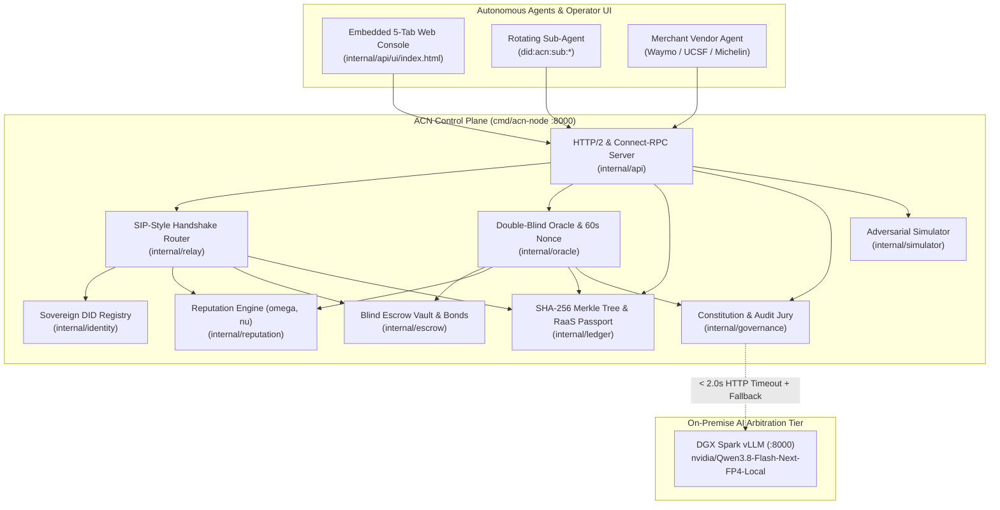

# ADR 0001: Go 1.27.4 Agentic Communication Network (ACN) Control Plane & Double-Blind Accountability Oracle

- **Status:** Accepted
- **Date:** 2026-11-14
- **Author:** Principal Systems Architect
- **Target Toolchain:** Go `1.27.4` (`CGO_ENABLED=0`)

---

## 1. Context and Problem Statement

Autonomous agents negotiating real-world reservations and commercial commitments require a low-latency, high-concurrency control plane capable of:
1. Authenticating sovereign agent identities (`did:acn:*`) and unlinkable rotating sub-agents (`did:acn:sub:*`) using `Ed25519` signatures.
2. Computing Sybil-resistant and Whale-resistant trust scores ($\omega$ Weight-of-Stake and $\nu$ Time-Weighted Velocity) in microseconds per request.
3. Managing atomic in-memory/stateful escrow locks with deterministic fee and slashing splits (`0.5%` integrity fee; `70%/30%` vendor/network slash split).
4. Resolving physical check-ins via a 60-second replay-protected challenge nonce and Double-Blind Mutual Attestation Oracle with `< 2.0s` AI Jury failover.
5. Generating SHA-256 Merkle inclusion proofs and selective-disclosure `TrustPassport` credentials for Reputation-as-a-Service (RaaS).

We must select the runtime architecture, package boundaries, concurrency primitives, and wire contracts to satisfy `mainframe` production invariants (`< 20 MB` static container image, `USER 10001:10001`, deterministic sub-second unit tests under `-race`).

---

## 2. Architectural Decision

We select **Go 1.27.4** (`module github.com/paulojauregui/acn-protocol`) using strictly encapsulated domain packages under `internal/` and the Go 1.27 standard library (`crypto/ed25519`, `crypto/sha256`, `crypto/hmac`, `net/http`, `embed`, `sync`, `math`).

---

## 3. Mathematical & Cryptographic Specifications

### 3.1 Weight-of-Stake ($\omega$) Endorsement Formula
To neutralize Sybil wash-trading where 1,000 zero-stake bots endorse each other:

$$T_{\text{new}} = \text{clamp}\left(T_{\text{old}} + \frac{\sum_{i=1}^{N} (R_i \times S_i \times V_i)}{N \times \text{ScaleFactor}}, 0.0, 5.0\right)$$

Where:
- $R_i \in [0.0, 5.0]$ is the endorser's current reputation score.
- $S_i \ge 0$ is the endorser's locked Good-Behavior Bond in USD.
- $V_i \ge 0$ is the settled transaction volume in USD.
- $\text{ScaleFactor} > 0$ normalizes capital-weighted endorsements.

If $S_i = 0$ (unbonded Sybil bot) or $V_i = 0$ ($0 wash ping), the numerator is strictly `0.0`.

### 3.2 Time-Weighted Velocity ($\nu$) Whale Defense
To prevent an attacker with `$1,000,000` in fresh capital (`AccountAgeDays` $\approx 0$) from monopolizing inventory:

$$\text{VelocityCapacity} = (\text{StakeUSD} \times \text{AccountAgeDays}) + (\text{SettledTxCount} \times \text{QualityWeight})$$

Maximum concurrent booking exposure (in USD) is bounded by $\min(\text{TierMaxUSD}, \text{VelocityCapacity})$. A 0-day-old account with `$1,000,000` stake and `0` settled transactions has near-zero initial velocity capacity until longitudinal history is accrued.

### 3.3 Reputation-Weighted Governance Voting ($V_i$)
Governance proposals and constitutional parameter updates weight each participant's vote by logarithmic stake multiplied by reputation:

$$V_i = \ln(1 + S_i) \times R_i$$

This prevents plutocratic capture by low-reputation capital holders while still requiring skin-in-the-game ($S_i > 0$).

---

## 4. Package Encapsulation & Dependency DAG

To prevent circular dependencies across `internal/`, packages follow a strict bottom-up Directed Acyclic Graph (DAG):

1. `internal/identity`: Zero internal dependencies. Owns `RootAgent`, `SubAgent`, `TrustTier`, and `Registry`.
2. `internal/reputation`: Zero internal dependencies. Owns composite score calculation, Weight-of-Stake ($\omega$), Time-Weighted Velocity ($\nu$), and exponential slash decay.
3. `internal/escrow`: Zero internal dependencies. Owns `BondAccount`, `EscrowLock`, `Vault`, `0.5%` integrity fee, and `70%/30%` slash distribution.
4. `internal/ledger`: Zero internal dependencies. Owns `InteractionRecord`, `ComputeMerkleRoot`, `InclusionProof`, and `TrustPassport` selective-disclosure signing/verification.
5. `internal/governance`: Zero internal dependencies. Owns `Constitution`, `Proposal`, $V_i = \ln(1+S_i) \times R_i$ voting, and `Jury` (`ArbitrateDispute` with `< 2.0s` DGX Spark HTTP client + deterministic fallback).
6. `internal/oracle`: Depends on `internal/escrow`, `internal/reputation`, `internal/ledger`, `internal/governance`. Owns 60s `ChallengeNonce` issuance and Double-Blind `SettleAppointment`.
7. `internal/relay`: Depends on `internal/identity`, `internal/reputation`, `internal/escrow`, `internal/ledger`. Owns SIP-style `Router` state machine.
8. `internal/simulator`: Depends on `internal/identity`, `internal/reputation`, `internal/escrow`, `internal/oracle`, `internal/governance`, `internal/relay`. Owns adversarial threat simulations.
9. `internal/api`: Depends on all domain packages and embeds `internal/api/ui/index.html`.
10. `cmd/acn-node`: Entrypoint wiring `internal/api` to `net/http` with graceful `SIGINT`/`SIGTERM` shutdown.

---

## 5. Consequences

- **Positive**: Zero C dependencies (`CGO_ENABLED=0`), sub-second compilation and `-race` testing, deterministic Merkle & Ed25519 cryptography, and full offline testability.
- **Mitigation**: Protobuf wire contracts are documented in `proto/acn/v1/acn.proto` and exposed via JSON/Connect-compatible HTTP endpoints in `internal/api` so clients can interact via standard `curl`, browser `fetch`, or gRPC-Web/Connect clients without requiring external `protoc` plugins during CI builds.
